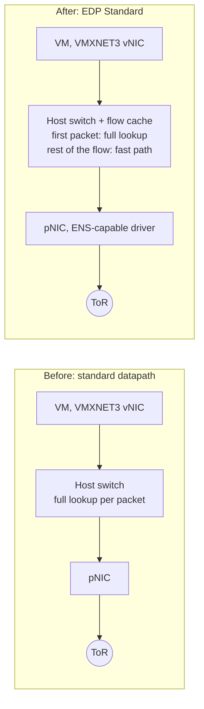
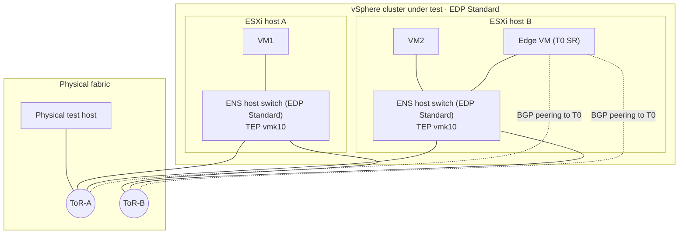

# EDP Enablement Test Plan (NSX / VCF)

## Scope

This is a plan to use when a cluster moves to Enhanced Datapath (EDP) on its NSX host transport nodes.

The idea is simple: run the same set of tests before and after, prove nothing broke, and show the
CPU-per-Gbps gain with numbers rather than a feeling. It covers both EDP modes, using the same names as the
blog post [NSX Enhanced Datapath: what it is, how to enable it, how to change modes](https://sorinplaton.github.io/posts/nsx-edp-performance-per-host/):

| UI (Advanced Configuration › Mode) | API `host_switch_mode` | What changes on the host |
|---|---|---|
| Standard | `STANDARD` | Normal datapath, vendor driver |
| Enhanced Datapath – Standard | `ENS_INTERRUPT` | ENS driver, interrupt driven, no dedicated cores |
| Enhanced Datapath – Performance | `ENS` | ENS driver, polling on dedicated logical cores; `cpu_config` is mandatory |

EDP Standard is what VCF 9.x picks by default for a new cluster. Newer Broadcom documentation (KB 402229) calls
EDP Performance "EDP Dedicated"; it is the same mode, `ENS` in the API.

If the target is EDP Performance, run the after set twice: once with every host on EDP Standard and once on
Performance, each in its own results folder. The cores in `cpu_config` poll all the time, so count them in the
host CPU numbers instead of comparing vmkernel network CPU alone.

One thing to get straight before measuring anything: the metric that moves is *CPU per Gbps, and pps with
small packets.*



Same VM, same vNIC, same pNIC, same ToR on both sides. The host switch is the only thing that changes, so
that's where the measurements should focus.

If you only run a large-packet iperf you'll probably conclude EDP did nothing. Look at vmkernel network CPU
and pps instead; that's where it shows up.

## 1. Pre-checks (before touching the TNP)

Nine times out of ten, when an EDP enablement fails it's the NIC or the driver. So check that first, host by
host. [`scripts/esxi-precheck.sh`](scripts/esxi-precheck.sh) collects the ESXi side in one go and
[`scripts/nsx-snapshot.sh`](scripts/nsx-snapshot.sh) the NSX side.

### NIC and driver capability

- [ ] Look up the exact NIC, driver and firmware combo in the
      [Broadcom Compatibility Guide](https://compatibilityguide.broadcom.com/) and make sure the EDP feature for your target mode is
      listed for it: "Enhanced Data Path - Interrupt mode" for EDP Standard, "Enhanced Data Path - Poll mode" for
      Performance.
- [ ] Save `esxcli network nic list` and `esxcli network nic get -n vmnicX` (driver and firmware) from every
      host. You'll want these later when comparing results.
- [ ] In NSX Manager, go to System → Fabric → Hosts, expand the cluster, click the host name to open the
      transport node, then open the Physical Adapters tab (on older 3.x builds it's System → Fabric → Nodes →
      Host Transport Nodes, same tab). Every uplink should say ENS Capable = True. If it says False, the driver
      can't do EDP and realization will fail with
      `Physical nic [vmnicX] ... is not capable for ENS_INTERRUPT mode`
      ([KB 404412](https://knowledge.broadcom.com/external/article/404412/one-or-more-transport-nodes-realization.html)).
      `GET /api/v1/transport-nodes/<id>/capabilities` gives you the same answer if you'd rather script it.
- [ ] Note the driver VIB versions: `esxcli software vib list | grep -iE "nmlx5|icen|i40en|ixgben|bnxtnet"`.
      ENS support is built into the native driver, so the version is what counts.

### vCenter

- [ ] During the rollout some hosts are on one mode and some on the other, and vMotion between them has to be
      allowed. Set the vCenter advanced setting `config.vpxd.network.allowVmotionBetweenENSModes = true`
      (vCenter › Configure › Advanced Settings, or `govc option.set config.vpxd.network.allowVmotionBetweenENSModes true`).
- [ ] There is room to empty one host at a time, with DRS fully automated or by manual vMotion.

### Configuration snapshot

- [ ] Export the TNP with `GET /policy/api/v1/infra/host-transport-node-profiles`. This doubles as your
      rollback copy.
- [ ] Clone the TNP: same host switch, same uplink profile, same IP pool, only the mode differs, plus
      `cpu_config` for Performance. Don't attach it yet; it goes on the cluster only once every host matches it.
- [ ] Export the VDS config. **PowerCLI:** `Export-VDSwitch -VDSwitch <name> -Destination vds-before.zip`.
      **Each ESXi host:** `esxcli network vswitch dvs vmware list` and `nsxcli -c "get host-switch"`.
- [ ] Write down NIOC shares, LAG/LACP, MTU, TEP count, and whether Edge VMs or vSAN share the uplinks.
      **ESXi host:** `esxcli network vswitch dvs vmware lacp status get` and `esxcli network ip interface list`
      (the TEP vmks). **PowerCLI:** `Get-VDSwitch | Select Name, Mtu, NetworkIOControlEnabled`. Any of these
      can explain a surprise later.

## 2. Baseline: same tests, run again after

Use one pair of test VMs per path and script the whole run, so the after-run is literally the same commands.
Tag every run with host, driver and a timestamp.



Test topology: 2 hosts, 2 ToRs, 1 Edge VM, 1 physical endpoint.

VM1 and VM2 live on one overlay segment behind the T1. For test 1, VM2 gets pulled onto host A; for the
cross-host tests it goes back to host B. The Edge VM holds the T0 SR and peers with both ToRs over BGP.

Setup is two Linux VMs (VMXNET3, 4 vCPU, iperf3 3.9 or newer, sockperf) and one physical box behind the ToR.
Pin placement with DRS rules, run each test three times for 60 s, keep the median, and don't touch the VMs or
Edges between the before and after runs.

Which devices each test group goes through:

| Tests | Path |
|---|---|
| 1 (same host) | VM1 → switch A → VM2 |
| 2–4 (overlay, VLAN, DFW) | VM1 → switch A → ToR → switch B → VM2 |
| 5, 7, 8, 10, 11 (north-south via Edge) | VM1 → switch A → ToR → Edge VM (T0 SR) → ToR → physical host |
| 6 (ECMP, two Edges) | VM1 → switch A → ToR → 2× Edge VM (T0 A/A) → ToR → physical host |
| 9 (no Edge, ToR SVI) | VM1 → switch A → ToR SVI → physical host |

Every test uses the same standard run (row 0). The rows below only add what's different: the setup, any
extra commands and where to type them, and what counts as a pass.
[`scripts/vm-run.sh`](scripts/vm-run.sh) runs row 0 from the client VM,
[`scripts/esxi-capture.sh`](scripts/esxi-capture.sh) captures the host side, and
[`scripts/summarize.py`](scripts/summarize.py) turns the raw output into the recording sheet.

| # | Test | Setup | Commands · where to enter them | Pass |
|---|---|---|---|---|
| 0 | Standard run (every test) | VM1 ↔ VM2 (Linux, VMXNET3, 4 vCPU). Hosts A/B: EDP Standard, TEP vmk10, uplinks to ToR-A/B | **Server VM:** `iperf3 -s` · `sockperf server` **Client VM:** `iperf3 -c <ip> -P 4 -t 60` · `iperf3 -c <ip> -u -b 0 -l 64 -P 4 -t 60` · `sockperf ping-pong -i <ip> -t 30 --full-rtt` **Each ESXi host (SSH):** `esxtop -b -d 5 -n 60 > run-<host>.csv` · `net-stats -A -t WwQqihVvc` · `esxcli network nic stats get -n vmnicX` | Record Gbps, pps, loss, p50/p99 RTT, vmkernel network CPU, pNIC errors |
| 1 | Same host, overlay | VM1 ↔ VM2, same host (A), overlay | **VM2:** `iperf3 -s` · `sockperf server` **VM1:** `iperf3 -c <vm2 ip> -P 4 -t 60` · `iperf3 -c <vm2 ip> -u -b 0 -l 64 -P 4 -t 60` · `sockperf ping-pong -i <vm2 ip> -t 30 --full-rtt` **Host A (SSH):** `esxtop -b -d 5 -n 60 > run-hostA.csv` · `net-stats -A -t WwQqihVvc` | UDP loss under 1% at 80% of the max measured |
| 2 | Cross-host, overlay | VM1 (host A) ↔ VM2 (host B), overlay via TEPs | **ESXi host:** `vmkping -I vmk10 -d -s 8972 <peer TEP>` before the run | No pNIC errors; after EDP within 5% of test 3 |
| 3 | Cross-host, VLAN | VM1 (host A) ↔ VM2 (host B), VLAN segment | **VM2:** `iperf3 -s` · `sockperf server` **VM1:** `iperf3 -c <vm2 ip> -P 4 -t 60` · `iperf3 -c <vm2 ip> -u -b 0 -l 64 -P 4 -t 60` · `sockperf ping-pong -i <vm2 ip> -t 30 --full-rtt` **Hosts A and B (SSH):** `esxtop -b -d 5 -n 60 > run-<host>.csv` · `net-stats -A -t WwQqihVvc` · `esxcli network nic stats get -n vmnicX` | Gap vs test 2 is the Geneve cost; smaller after EDP |
| 4 | DFW in path | VM1 ↔ VM2 cross-host, DFW allow TCP/UDP 5201, drop TCP 5202 | **Client VM:** `nc -zv <ip> 5202` **ESXi host:** `vsipioctl getflows -f <filter>` | 5202 times out, 5201 flow listed; gap vs test 2 smaller after EDP |
| 5 | N-S routed | VM1 → T1 → T0 SR (Edge VM) → ToR → physical host | **Edge CLI:** `get dataplane cpu stats` **Edge's ESXi host:** esxtop as in row 0 | Gbps flat (the Edge is the ceiling); workload host CPU down |
| 6 | N-S ECMP | VM1 → T0 A/A on 2+ Edge VMs → ToR-A/ToR-B (ECMP) → physical host | **Four client VMs:** `iperf3 -c <physical ip> -P 16 -t 60` **Each Edge CLI:** `get interfaces` | Every Edge carries traffic; aggregate scales with Edge count |
| 7 | N-S with SNAT | Test 5 + SNAT on T1 | Standard run. **Edge CLI:** `get logical-routers` to find the T1 SR UUID, then `get logical-router <t1-sr-uuid> nat` for the rule hit counter | Within 10% of test 5 |
| 8 | N-S with Gateway Firewall | Test 5 + GFW allow / drop TCP 5202 on T1 or T0 | **Client VM:** `nc -zv <physical ip> 5202` | 5202 times out; allow passes at test-5 throughput |
| 9 | N-S VLAN, no Edge | VM1 (VLAN segment) → ToR SVI → physical host, no Edge | **Physical host:** `iperf3 -s` · `sockperf server` **VM1:** `iperf3 -c <physical ip> -P 4 -t 60` · `iperf3 -c <physical ip> -u -b 0 -l 64 -P 4 -t 60` · `sockperf ping-pong -i <physical ip> -t 30 --full-rtt` **Host A (SSH):** `esxtop -b -d 5 -n 60 > run-hostA.csv` · `net-stats -A -t WwQqihVvc` · `esxcli network nic stats get -n vmnicX` | Near pNIC line rate; CPU per Gbps down after EDP |
| 10 | Edge VM on an EDP host | Edge VM on EDP host B, then test 5 | Same as test 5 | No loss; Edge at least matches its standard-host result |
| 11 | Edge failover under load | Test 5 for 5 min, active Edge VM failed mid-run | **Client VM:** `iperf3 -c <physical ip> -u -b 1G -t 300` and `iperf3 -c <physical ip> -t 300` **Active Edge CLI:** `set maintenance-mode enabled` **Surviving Edge CLI:** `get bfd-sessions` **ToR:** `show ip bgp summary` (Cisco, Arista) or `show bgp summary` (Juniper) | Outage within BFD interval × multiplier plus BGP convergence; TCP session survives; repeat for failback |

### Test 1 in detail: VM to VM on the same host

This is the baseline everything else is measured against, and it's deliberately the simplest case.

**What it isolates.** VM1 and VM2 share host A, so a packet goes VM1 → vNIC → ENS host switch → vNIC → VM2 and
never touches a pNIC, a TEP or the ToR. No Geneve, no uplink, no fabric. The only thing in the path is the
host switch, which is exactly what EDP changes. Whatever moves between the before and after runs here is pure
datapath cost.

**Setup.** Both VMs on one overlay segment behind the T1, with a DRS keep-together rule so they stay on host A
for the whole run. If DRS drifts one of them to host B mid-test you're measuring test 2 without knowing it.

**Run.** The standard run from row 0: `iperf3 -s` and `sockperf server` on VM2; on VM1,
`iperf3 -c <ip> -P 4 -t 60` for throughput, `iperf3 -c <ip> -u -b 0 -l 64 -P 4 -t 60` for pps with 64-byte
frames, and `sockperf ping-pong -i <ip> -t 30 --full-rtt` for latency. On host A over SSH:
`esxtop -b -d 5 -n 60 > run-<host>.csv`, `net-stats -A -t WwQqihVvc`, `esxcli network nic stats get -n vmnicX`.

**Record.** Gbps, pps and loss from the UDP run, p50/p99 RTT from sockperf, vmkernel network CPU from esxtop.
CPU is the number that matters here; large-packet Gbps between two VMs on one host will look about the same
before and after.

**Pass.** No target throughput. The check is that UDP loss stays under 1% while pushing about 80% of the
maximum pps you measured. Loss above that at a sub-max rate means the switch is dropping under load before the
network is even involved.

**Why it's first.** It sets the ceiling. Every later test adds something (Geneve, the uplink, the Edge), so if
test 2 lands well under test 1 you know the gap is the TEP path, not the host switch.

### Recording sheet

One line per test per phase. Enter the median of the three runs; keep the raw iperf3/sockperf output and the
esxtop CSVs alongside, named by test number, phase and host (e.g. `t02-before-hostA.csv`). Tests 6 and 11
have their own metrics, noted in the row. The sheet is in [`sheets/recording-sheet.csv`](sheets/recording-sheet.csv).

Cluster: ______ · Hosts: ______ · NIC / driver / firmware: ______ · Edge form factor: ______

**About the p50 / p99 µs column.** These are round-trip latency percentiles in microseconds, taken from the
`sockperf ping-pong --full-rtt` run. sockperf sends one small packet at a time, waits for the reply, and
records each round trip. Sort all of those round trips and p50 is the middle one: half the packets came back
faster, half slower.

That's your typical latency. p99 is the value only 1% of packets exceeded, so it's the tail: how bad it gets
for the slow ones.

Record both because they tell different stories. p50 barely moves between the standard datapath and EDP; p99
is where interrupt coalescing, queue contention and flow-cache misses show up. A good EDP result is a p99 that
drops and sits closer to p50. A p99 that gets worse while p50 improves usually means a share of flows is
missing the fast path, which is the moment to look at `nsxdp-cli ens flow-table stats get`.

An average is not a substitute: a few long round trips drag it up without telling you whether it was one bad
packet or many. Write it as `p50 / p99`, for example `38 / 95`, from the summary lines sockperf prints at the
end (`percentile 50.000` and `percentile 99.000`).

## 3. Enable

Don't change the mode in the TNP that is attached to the cluster. On a cluster that already runs NSX, NSX 4.2.4
refuses a direct `STANDARD` ⇄ `ENS` change with error 9544 (at cluster level and per host) and asks you to
delete the host switch, which pulls the overlay out from under every VM. Instead, change one host at a time in
maintenance mode, and attach the cloned TNP to the cluster at the end.

A host only moves one step at a time, with EDP Standard in the middle:
`STANDARD` ⇄ `ENS_INTERRUPT` ⇄ `ENS`. For EDP Standard that is one hop per host; for Performance it is two,
about 10 seconds each. The workloads never see the datapath change, only the vMotion that empties each host.

1. vMotion everything off host 1 and put it in maintenance mode. **PowerCLI:**
   `Set-VMHost -VMHost <host> -State Maintenance -Evacuate`, or `govc host.maintenance.enter <host>`.
2. Change the host switch mode on that host: **Configure NSX** on the host, Edit the host switch, Advanced
   Configuration, Mode. From Standard the list only offers Standard and Enhanced Datapath – Standard; for
   Performance, run it a second time and set the mandatory CPU Config (NUMA node and lcores).
3. Wait for the transport node to be realized in the new mode. **ESXi host:**
   `nsxcli -c "get transport-node status"`.
4. Run the per-host checks from section 4 before taking the host out of maintenance mode.
5. Next host. While you go, NSX marks the converted hosts as *Mismatch*; that is expected.
6. When every host is in the new mode, attach the cloned TNP to the cluster. Every host already matches it, so
   NSX goes straight to `SUCCESS`. Then run the full regression.

Rollback is the same loop the other way (`ENS` → `ENS_INTERRUPT` → `STANDARD`), then the original TNP on the
cluster.

### Script option (NSX Policy API)

The UI writes the policy *host transport node*, so the API path per host is: read it, change
`host_switch_mode` (and `cpu_config` for Performance), write it back with the same `_revision`, wait.

```bash
read -rp  "NSX Manager FQDN or IP: " NSX
read -rp  "NSX user [admin]: " NSX_USER; NSX_USER=${NSX_USER:-admin}
read -rsp "NSX password: " NSX_PASS; echo
EP=/policy/api/v1/infra/sites/default/enforcement-points/default
nsx() { curl -sk -u "$NSX_USER:$NSX_PASS" -H 'Content-Type: application/json' "$@"; }

read -rp "Host to change: " HOST
TN=$(nsx "https://$NSX$EP/host-transport-nodes" | jq -r --arg h "$HOST" '.results[] | select(.display_name==$h) | .id')

# keep the rollback copy, then hop to EDP Standard
nsx "https://$NSX$EP/host-transport-nodes/$TN" | tee "tn-$HOST-before.json" \
  | jq '.host_switch_spec.host_switches[].host_switch_mode = "ENS_INTERRUPT"
      | .host_switch_spec.host_switches[].cpu_config = []' > tn-hop1.json
nsx -X PUT "https://$NSX$EP/host-transport-nodes/$TN" -d @tn-hop1.json

# wait until realized (success / success)
nsx "https://$NSX$EP/host-transport-nodes/$TN/state" | jq -r '.state, .node_deployment_state.state'

# EDP Performance only: second hop, read again because the revision moved
nsx "https://$NSX$EP/host-transport-nodes/$TN" \
  | jq '.host_switch_spec.host_switches[].host_switch_mode = "ENS"
      | .host_switch_spec.host_switches[].cpu_config = [{"numa_node_index":0,"num_lcores":2}]' > tn-hop2.json   # your NUMA node and lcores
nsx -X PUT "https://$NSX$EP/host-transport-nodes/$TN" -d @tn-hop2.json
```

When every host is done, point the cluster's transport node collection to the cloned TNP
(`PUT .../transport-node-collections/<id>` with `transport_node_profile_id`). The blog post has the full
commands, and [`tools/edp_per_host.py`](tools/edp_per_host.py) runs the whole loop: evacuation, maintenance
mode, the hops, the wait and the profile at the end, for any target mode, with `--dry-run` to see the plan
first.

## 4. Post-enable validation

[`scripts/esxi-validate.sh`](scripts/esxi-validate.sh) runs the host-side checks below and saves the output.

### Confirm the mode actually took, per host

- [ ] `nsxcli -c "get host-switch"` should now report the new mode: ENS interrupt for EDP Standard, ENS for
      EDP Performance
- [ ] `nsxdp-cli ens switch list` shows the host switch as an ENS switch (with the lcores you set, for
      Performance), and `nsxdp-cli ens port list` lists your VM ports and uplinks
- [ ] `esxcfg-nics -e` shows the NSX uplinks on the `_ens` driver with `ENS Driven = True`
- [ ] `nsxdp-cli ens uplink list`: every uplink has to be ENS. One that isn't means the NIC fell back, and
      that host isn't really on EDP.
- [ ] `nsxdp-cli ens flow-table dump` and `nsxdp-cli ens stats get`. Hits should climb once traffic is
      flowing. If the miss rate stays high, something (DFW rule churn, fragmentation) is kicking flows out of
      the fast path.

### Transport node health

- [ ] The NSX UI shows the transport node Up with the new host switch mode (a *Degraded* right after the
      driver swap can be a cached pNIC status: `GET /api/v1/transport-nodes/<id>/status?source=realtime`
      gives the real one), and **ESXi host:**
      `nsxcli -c "get transport-node status"` agrees
- [ ] **ESXi host:** `nsxcli -c "get bfd-sessions"` shows the TEP BFD sessions up, and
      `nsxcli -c "get tunnel-ports"` lists every tunnel; the UI shows them green

### Functional regression

- [ ] Re-run every path in the section 2 table
- [ ] MTU didn't move. **ESXi host:** `vmkping -I vmkX -d -s 8972 <TEP>` with DF set on a 9000 MTU underlay
- [ ] vMotion a VM onto an EDP host and back off it while iperf3 is running, and watch for drops.
      **PowerCLI:** `Move-VM -VM <vm> -Destination <host>`
- [ ] DFW still does its job: the blocked flow stays blocked, the stateful allow passes, and **ESXi host:**
      `vsipioctl getrules -f <filter>` still lists the filter on the ENS port
- [ ] If Edge VMs live here, fail a T0 over (vMotion the Edge) and make sure BGP comes back. **Edge CLI:**
      `get logical-routers`, then `vrf <t0-sr-id>` and `get bgp neighbor summary`. North-south numbers should
      match.
- [ ] vSAN or NFS sharing the uplinks: latency hasn't regressed. **ESXi host:** `vsantop` for vSAN, or
      `esxtop` then `u` for NFS datastore latency; the vSAN Performance view in the UI gives the before/after
      graph. EDP changes how the uplink queues, so this one is worth a look.
- [ ] Offloads. **ESXi host:** `esxcli network nic get -n vmnicX` shows TSO/LRO/RSS unchanged, and
      `nsxdp-cli ens port stats` shows Geneve offload hits if the NIC supports it

### Soak

Then leave it alone for a day or two.

Then, on each **ESXi host**, compare `esxcli network nic stats get -n vmnicX` error and drop counters against
the baseline, and run `grep -iE "ens|reset" /var/log/vmkernel.log` for ENS or driver resets, before you touch
the next cluster.

## 5. Compare: results per cluster

What you should see: pps up and vmkernel network CPU down, on both the VM-to-VM and the TEP paths.

If cross-host overlay didn't move, check the flow-table miss rate first, then confirm the uplink really is in
ENS mode. On the ESXi host (SSH):

```bash
# flow-table hit/miss rate
nsxdp-cli ens flow-table stats get

# uplinks really in ENS mode (every uplink should be listed)
nsxdp-cli ens uplink list
```

If `flow-table stats get` isn't accepted on your build, `nsxdp-cli ens stats get` shows the same hit/miss
counters, and `nsxdp-cli ens flow-table dump` shows which flows are landing in the cache.

Those two explain most disappointing results.

Cluster: ______ Hosts: ______ NIC / driver / firmware: ______

The comparison table is in [`sheets/compare.csv`](sheets/compare.csv);
`scripts/summarize.py --compare` fills the iperf3 and sockperf rows from the saved runs.

| # | Path | Metric | Before | After | Delta |
|---|---|---|---|---|---|
| 1 | VM↔VM same host, overlay | Throughput (Gbps) | | | |
| 1 | VM↔VM same host, overlay | pps at 64 B (Mpps) | | | |
| 1 | VM↔VM same host, overlay | Latency p50 / p99 (µs) | | | |
| 2 | VM↔VM cross-host, overlay | Throughput (Gbps) | | | |
| 2 | VM↔VM cross-host, overlay | pps at 64 B (Mpps) | | | |
| 2 | VM↔VM cross-host, overlay | Latency p50 / p99 (µs) | | | |
| 3 | VM↔VM cross-host, VLAN | Throughput (Gbps) | | | |
| 3 | VM↔VM cross-host, VLAN | pps at 64 B (Mpps) | | | |
| 4 | DFW stateful allow | Throughput (Gbps) | | | |
| 5 | N-S routed via T0 | Throughput (Gbps) | | | |
| 5 | N-S routed via T0 | pps at 64 B (Mpps) | | | |
| 5 | N-S routed via T0 | Latency p50 / p99 (µs) | | | |
| 5 | N-S routed via T0 | Edge datapath CPU (%) | | | |
| 6 | N-S ECMP | Aggregate throughput (Gbps) | | | |
| 6 | N-S ECMP | Flow spread per Edge (%) | | | |
| 7 | N-S with SNAT | Throughput (Gbps) | | | |
| 8 | N-S with GFW | Throughput (Gbps) | | | |
| 9 | N-S VLAN, no Edge | Throughput (Gbps) | | | |
| 9 | N-S VLAN, no Edge | pps at 64 B (Mpps) | | | |
| 10 | Edge VM on EDP host | Throughput (Gbps) | | | |
| 10 | Edge VM on EDP host | Edge host network CPU (%) | | | |
| 11 | Edge failover | Outage (s) | | | |
| 11 | Edge failover | UDP packets lost (count) | | | |
| — | Workload host | vmkernel network CPU (%) | | | |
| — | Workload host | pNIC drops / errors (count) | | | |
| — | Workload host | Flow-table hit rate (%) | n/a | | |

## Sources

- [Improving VCF Performance with Enhanced Data Path (Broadcom VCF blog)](https://blogs.vmware.com/cloud-foundation/?p=32165)
- [KB 404412: transport node realization failure, ENS_INTERRUPT](https://knowledge.broadcom.com/external/article/404412/one-or-more-transport-nodes-realization.html)
- [Is my NIC supported with EDP in VCF 9.0? (William Lam)](https://williamlam.com/2025/06/is-my-nic-supported-with-enhanced-data-path-edp-with-vcf-9-0.html)
- [NVIDIA RDG: vSphere 8 with NSX 4.x Enhanced Data Path](https://networking-docs.nvidia.com/sol/rdg-for-vmware-vsphere-8-0-with-nsx-4-x-accelerated-by-nvidia-networking)
